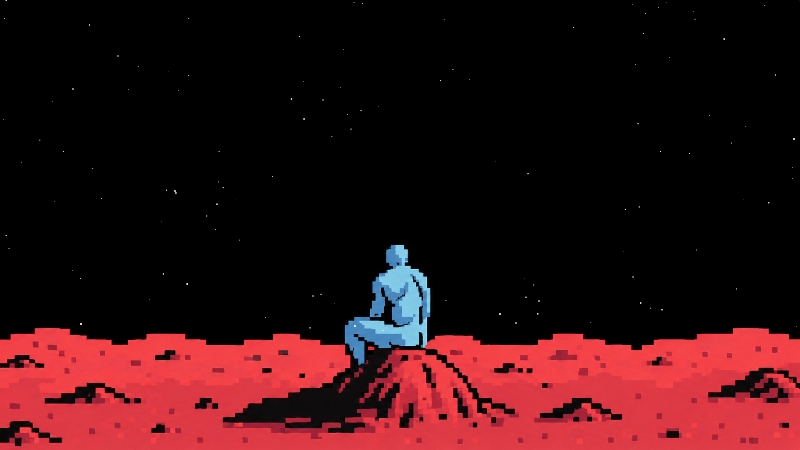

# 🌌 SPECTER2028

### Exploring the universe, one pixel at a time.

Welcome to my little corner of the internet, where code meets the cosmos.

---

## ✨ Stary Night

A cinematic pixel-art space scene featuring a peaceful lunar landscape and a rotating celestial starfield.

  

### 🌠 Features

- Smooth, continuous circular starfield rotation.
- A galaxy-like effect with stars orbiting around a central point.
- Dynamically generated pixel stars.
- Adjustable star size, brightness, density, and rotation speed.
- Sky-only clipping to preserve the lunar landscape.
- A peaceful, cinematic atmosphere with a completely black sky.

### 🛠️ Built With

HTML5 · CSS3 · JavaScript · Canvas API

### 🚀 Explore the Project

[View the Source Code](https://github.com/specter2028/specter2028)

---

*Building things, learning new technologies, and exploring the possibilities of code.*

